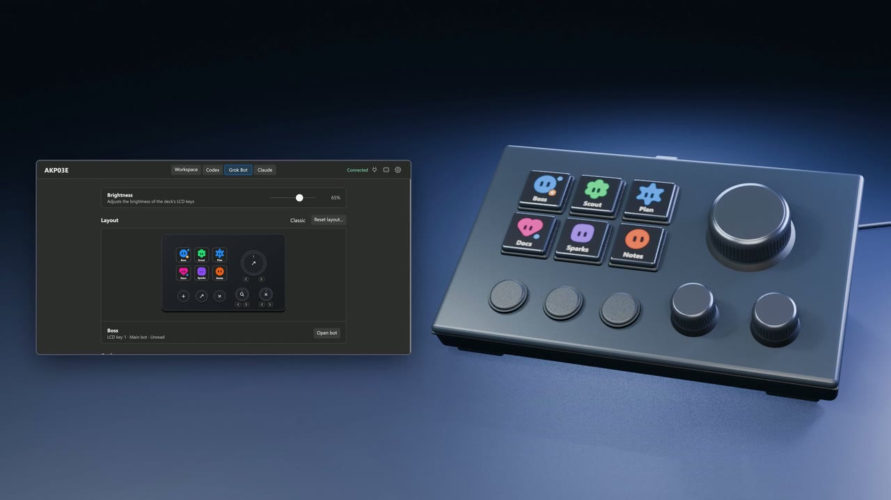

# DeckX

DeckX is an open-source desktop app for programmable decks. Use physical keys and dials to launch apps, run workflows, switch between agents, and see usage limits at a glance.

**Available for Windows. macOS support is coming soon.**

[](https://github.com/sepivip/DeckX/releases/download/v0.7.13/DeckX-Demo.mp4)

[Download DeckX for Windows](https://github.com/sepivip/DeckX/releases/tag/v0.7.13) · [Watch the demo](https://github.com/sepivip/DeckX/releases/download/v0.7.13/DeckX-Demo.mp4) · [Music credit](THIRD_PARTY_NOTICES.md#demo-soundtrack)

## Supported decks

| Deck | Connection | Platform |
| --- | --- | --- |
| AJAZZ AKP03E (`0300:3002`) | Wired USB HID | Windows |

**Help bring DeckX to more decks.** If you have another model, share its control layout and what you can test, or help implement its device backend. [Request or offer deck support](https://github.com/sepivip/DeckX/issues/new?template=deck-support.yml) · [How to contribute files](CONTRIBUTING.md#contribute-files-on-github)

## Install and run

Run the **Windows x64 setup** for a per-user installation, or extract the **portable ZIP** to run from a folder of your choice. [Windows downloads](https://github.com/sepivip/DeckX/releases/latest)

1. Exit Stream Dock from the Windows system tray.
2. Plug in the AKP03E. Open **DeckX** from Start or run `deckx.exe` from the extracted ZIP.
3. Select **Connect** to load your saved workspace onto the deck.
4. Select a control and click an action, or drag an action from the palette onto the control.
5. Set its options in the inspector and select **Save workspace** or press **Ctrl+S**. Keep DeckX open to run your bindings.

Only one DeckX runs at a time. Opening it again brings the running window to the front. If the deck is unplugged or stops responding, DeckX reconnects when it returns. Disconnecting or closing DeckX blanks the LCD keys.

Use **Settings → Apps → Installed apps** in Windows to uninstall DeckX. DeckX keeps the workspace and settings in `%LOCALAPPDATA%\DeckX`.

Turn on **Settings → General → Minimize to tray** to keep the deck running when you minimize the window. Click the DeckX icon in the Windows notification area to restore the window, or right-click it for **Open DeckX** and **Quit DeckX**.

## Workflows

- **Key layout.** Edit the six LCD keys, three side buttons, and all three gestures on each dial. Drag controls to swap bindings, or right-click to copy and paste. LCD keys support labels, colors, and PNG or JPEG images with a preview in the inspector.
- **Profiles and pages.** Create a profile from the profile picker. Use **Page** and **Folders** to add layouts. Bind **Next page**, **Go to page**, **Open deck folder**, or **Switch profile** to navigate from the hardware. New folders start with a back binding.
- **App associations.** Select a profile, open **Settings**, and link a Windows executable. DeckX switches to that profile when the app has focus and returns to the manually selected layout when you focus an unlinked app.
- **Multi actions.** Bind **Multi action**, add steps in the inspector, and use **Delay** for timed sequences. Steps can launch apps, open links or files, type text, send shortcuts, and control media.
- **Display and backups.** Adjust brightness and rotation, or export and import DeckX JSON, in **Settings**.

## Stream Deck plugins

1. Open **Plugins → Marketplace** to browse or search Elgato's live catalog. **Install in DeckX** downloads a public package from a publisher linked in the listing. For other listings, open the official listing, then import the downloaded `.streamDeckPlugin` or an installed `.sdPlugin` folder from **Plugins → Installed**. Elgato normally keeps installed plugins under `%APPDATA%\Elgato\StreamDeck\Plugins`.
2. Enable the installed plugin and wait for **Running**. Importing a newer version of an installed plugin updates it, and the trash button uninstalls it. For a Node plugin, DeckX uses `node.exe` on PATH or the runtime chosen in **Plugins → Installed → Node.js**.
3. Drag a plugin action from the action list onto a key or dial, then save the workspace. Encoder actions bind the whole dial.
4. Open **Configure plugin** from the binding inspector when the plugin provides a configuration page. Plugin settings are stored separately from workspace JSON under `%LOCALAPPDATA%\DeckX\PluginHost`.

DeckX hosts Windows executable, Node.js, and browser-based plugin entry points. Browser backends use Microsoft Edge with a separate profile. Settings pages open in your browser. Support covers the public local Stream Deck API described in the [plugin compatibility notes](docs/plugin-host.md). Plugins that depend on Elgato services, companion apps, or a touchscreen can have additional requirements.

## Agent modes

Select **Codex**, **Grok Bot**, or **Claude**. Click a key or dial in **Layout** to edit its assignment, including unassigned controls. The editor has separate **Turn left**, **Press**, and **Turn right** tabs for a dial. Choose **Save** to apply the draft to the connected deck. **Use default** restores one assignment. **Reset layout** restores all assignments for the current mode. Right-click a chat or bot key in the preview to open it.

Choose **Options → Agent keys → 5 keys + usage** to show the mode’s usage limits on LCD key 6. The rectangular outline fills clockwise from top center and follows the lowest remaining percentage on the key. Press the key or click its preview to see the usage windows, when they were read, and reset times when available. The preset is saved per mode. Select the other preset to restore key 6’s saved assignment.

Choose **Options → Main dial → Switch modes** to cycle through Codex, Grok Bot, and Claude. Turning right follows that order and turning left reverses it. The setting is shared across the three modes. Press the dial to run its assigned action.

Turn on **Settings → General → Easter egg**. Tap the leftmost round button under the LCD grid, then immediately hold the rightmost round button for two seconds. The six screens show Sydney Sweeney for five seconds before returning to the active layout.

The Sydney Sweeney photo was cropped and resized from [ChristyBFILFF171025-43 by Raph_PH](https://www.flickr.com/photos/raph_ph/54876916334/), licensed under [CC BY 4.0](https://creativecommons.org/licenses/by/4.0/).

**Codex.** The six LCD keys follow recent local chats by default. Chat keys show the title and live status when available. On the deck, tap to select a chat or double-tap to open it. Turn the main dial to select a chat and press it to open.

Use **Key style** beside **Layout** to switch between **Color titles** and **Classic**. Color titles use up to three left-aligned lines and colors adjusted for text contrast. Classic fills the LCD keys with the Codex Micro status colors. The title renderer uses OpenAI Sans from the installed Codex desktop package when available and falls back to Inter.

The default side buttons open a new Codex chat, open the selected chat, and exit Codex Mode, in that order. Assignments are stored in `%LOCALAPPDATA%\DeckX\codex-layout.json`. Start DeckX with `--connect --codex-mode` to enter the mode on launch.

The **ChatGPT & Codex** action group also provides individual desktop actions for regular profiles. See the [Codex Micro interoperability notes](docs/codex-micro.md).

**Grok Bot.** In Classic layout, the starred main bot is at the top left and the other five keys follow recent bot activity. DeckX remembers the main bot after identifying it in Grok Bot's sidebar. Animated avatars and unread dots come from Grok's installed app and cached roster, so they continue while Grok Bot is minimized. Press a deck key once to open its bot. Turn the main dial to select an assigned bot and press it to open the selection. The default side buttons create a bot, open the selection, and exit. Press the second dial to search. Assignments are stored in `%LOCALAPPDATA%\DeckX\grok-layout.json`. Start DeckX with `--connect --grok-mode` to enter this mode on launch.

**Claude.** Click an LCD key, choose **Pin a Claude chat**, and enter its chat link or ID and an LCD title. One press on the deck opens the pinned conversation using Claude Desktop. Turn the main dial to select a pinned chat and press it to open. The default side buttons start a new chat, open the selection, and exit. Assignments are stored in `%LOCALAPPDATA%\DeckX\claude-layout.json`. Start DeckX with `--connect --claude-mode` to enter this mode on launch. [Claude mode design](docs/claude-desktop-mode.md)

## Storage

The workspace is saved to `%LOCALAPPDATA%\DeckX\profile.json`, and each save keeps the previous version as `profile.json.bak`. If DeckX cannot read the workspace, it starts from a default one and shows the error. Saving then keeps the unreadable file as `profile.json.unreadable-<time>` instead of replacing it. DeckX 0.1 profiles load as **Default / Page 1** and are upgraded on the next save. Custom images are referenced by their original paths. Shortcuts such as `Ctrl+Shift+M` go to the foreground app. New profiles have volume on dial 1 and playback on dial 2.

## Build

On Windows with Rust 1.93 or later and the MSVC toolchain:

```powershell
cargo build --release --locked
.\target\release\deckx.exe
```

To check that Windows can open the device interface without sending reports:

```powershell
cargo run --locked -- --probe
```

See the [architecture notes](docs/architecture.md), the [AJAZZ hardware notes](docs/reverse-engineering.md) for HID evidence, and the [Stream Deck reference notes](docs/stream-deck-reference.md) for the editor and feature analysis.

## Configure DeckX through Codex

In DeckX, open **Settings → MCP** and select **Add to Codex**. Keep DeckX open and restart Codex after adding the server. The MCP tab shows the local server status, Codex setup status, and the most recent client request.

You can also add the server from PowerShell. Codex starts MCP servers with a reduced environment, so pass `LOCALAPPDATA`. The server reads the running app's endpoint from `%LOCALAPPDATA%\DeckX`.

```powershell
codex mcp add deckx --env "LOCALAPPDATA=$env:LOCALAPPDATA" -- (Resolve-Path .\target\release\deckx.exe).Path --mcp
```

Ask Codex to inspect the current workspace, create or edit a profile, assign an LCD key or dial gesture, set brightness, configure Codex Mode, or find and configure a plugin. When Codex asks to enable a plugin, DeckX asks you to approve it first. Tools use one-based control indices and the profile and page IDs returned by `deckx_state`. Workspace batches are validated and saved together. `applied_brightness` and `applied_key_style` report successful device writes. See the [tool examples](docs/mcp.md).

## License

DeckX is licensed under the [MIT License](LICENSE). Bundled assets and the demo soundtrack have their own [licenses and credits](THIRD_PARTY_NOTICES.md).
